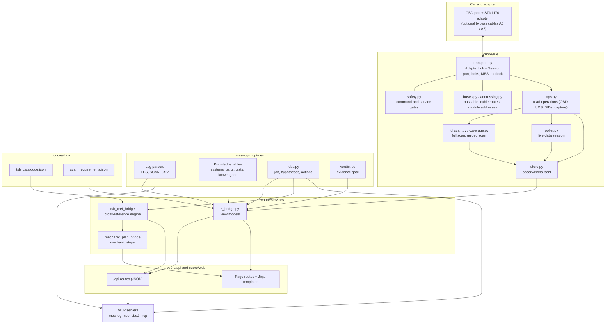
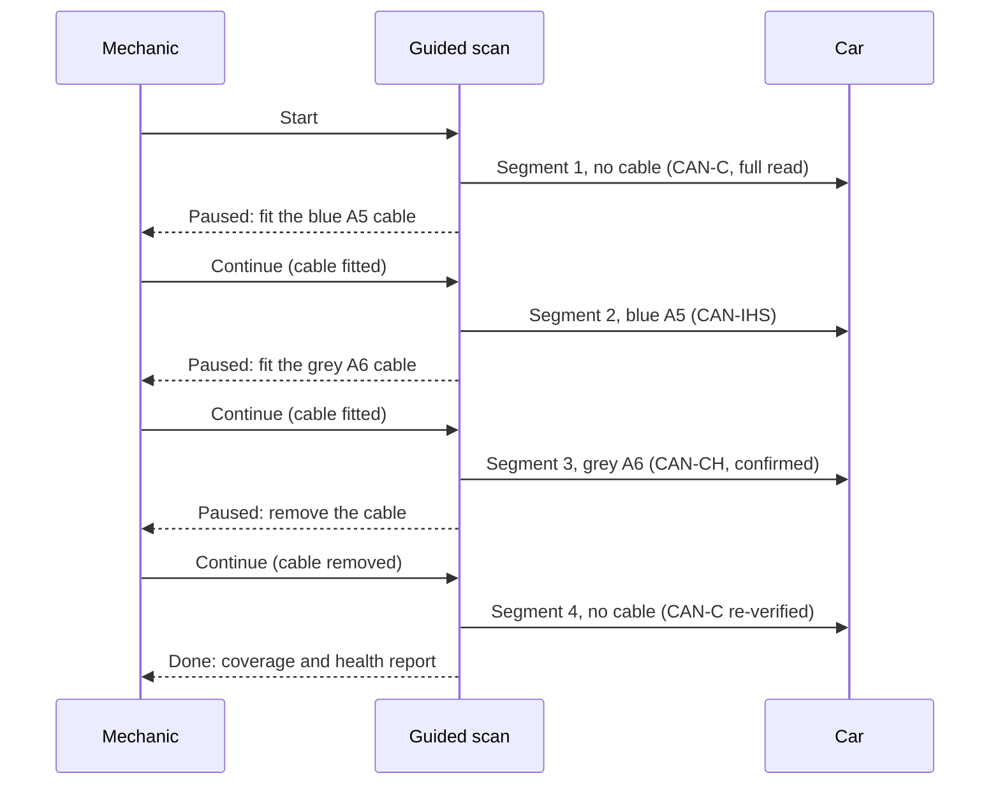

# CUORE architecture

This page describes how CUORE is put together: the layers between the adapter
and the browser, the files it keeps, how a guided scan and an adapter session
run, and how evidence is recorded and graded. It describes the code as it is
in the repository. For the page-by-page tour see [FEATURES.md](FEATURES.md);
for the decisions behind it see the [handbook](handbook/README.md).

## Programs

| Program | Directory | Role |
|---|---|---|
| CUORE web app | `cuore/` | FastAPI application: JSON API under `/api`, server-rendered pages everywhere else. Owns the adapter. |
| MES log library and MCP server | `mes-log-mcp/` | `mes/` is the analysis library (standard library only, no web or MCP imports). `server.py` exposes it as MCP tools. |
| Live-link MCP server | `obd2-mcp/` | MCP tools for the adapter. Reads are HTTP calls to the running CUORE app (`cuore_client.py`); it runs the same code in process only if CUORE cannot be reached. |

Dependency direction: `cuore` imports `mes`, `mes` never imports `cuore`.
`cuore/services/mes_bridge.py` is the one module that imports `mes` for the
log analysis; each other `*_bridge.py` wraps one `mes` submodule or one
`cuore.live` module. Pages and API routes call a bridge, so the HTML and JSON
surfaces cannot disagree.

## Layers



Reading the diagram from the bottom of the chain up:

1. **Live transport** (`cuore/live/transport.py`). `AdapterLink` is the one
   object that opens the serial port. Each operation opens the port, does its
   work and closes it; nothing stays open between calls except a live-data
   poll session. A `Session` wraps the open stream and sends commands.
2. **Buses and addressing** (`buses.py`, `addressing.py`, `framing.py`,
   `obd.py`, `uds.py`). Pure data and pure parsers: the three CAN buses, which
   cable reaches which bus, adapter protocol presets per bus, module addresses
   with a confidence grade, DID catalogue, ISO-TP and J1979 decoding. Source
   of truth for the data is [reference/GIORGIO_MODULE_MAP.md](reference/GIORGIO_MODULE_MAP.md);
   values the map marks unknown stay `None`.
3. **Ops** (`ops.py`). The operations both surfaces call. Every function
   returns a plain dict that names the bus and cable used. HTTP routes and MCP
   tools are wrappers over these functions.
4. **Full scan and guided scan** (`fullscan.py`, `coverage.py`). Sequencing on
   top of ops: one read-only pass over every bus the declared cable reaches,
   with a pause at each cable swap in the guided variant.
5. **Observation store** (`store.py`). Every read is appended to
   `observations.jsonl`. This is the only live-data input to the evidence gate
   and to the Scans area.
6. **Bridges** (`cuore/services/*_bridge.py`). Each turns stores, the `mes`
   library and the observation log into the view model a page or API route
   needs. Bridges import optional dependencies lazily so a missing module
   degrades one page instead of failing the app.
7. **Routes and templates** (`cuore/api/*.py`, `cuore/web/*_routes.py`,
   `cuore/web/templates/`). `/api/*` returns JSON and mirrors the MCP tools;
   the page routes render Jinja templates with no build step and no
   single-page-app bundle.

Two pipelines run beside the live path:

- **MES log package to jobs and hypotheses.** `mes/` parses MultiEcuScan's
  own text logs (`FESLog_*`, `SCAN_*`) and CSV recordings, derives the vehicle
  dossier (`workup.py`), fault trees (`faulttree.py`) and the evidence gate
  (`verdict.py`), and holds the append-only job store (`jobs.py`): one job
  per visit, with complaint, hypotheses, actions and verification.
- **TSB catalogue to cross-reference to mechanic plan.**
  `cuore/data/tsb_catalogue.json` is read by `tsb_xref_bridge.py`, which
  relates each bulletin to the car's codes, the repairs already on the job, the
  open hypotheses and the systems-dependency graph by explicit rules, each
  with a stated reason. `mechanic_plan_bridge.py` turns one hypothesis plus
  that cross-reference into ordered, numbered mechanic steps, each citing its
  source.

### Application profiles

`cuore/profiles.py` defines two profiles, `bench` (this PC: log corpus, every
analysis, the adapter) and `drive` (reserved for an in-car node). Clients ask
`/api/capabilities` what the host can do and render that answer. Only `bench`
is implemented in this repository.

## Data files

Static reference data ships in `cuore/data/`:

| File | Content | Used by |
|---|---|---|
| `tsb_catalogue.json` | Bulletins, recalls, CSNs, campaigns and field reports for the reference car, plus rows for sibling engines (`vehicle_scope`: `this_model` or `sibling_engine`). Each row carries `applies` (`yes`, `no`, `vin_check`) and a `verified` flag. The schema is described inside the file. | `tsb_bridge`, `tsb_xref_bridge`, `mechanic_plan_bridge` |
| `scan_requirements.json` | The explicit list of what a scan must capture for the open job on the reference car: id, label, why, source kind, and how to recognise the evidence. | `scan_requirements_bridge` |

Reference documents in `docs/reference/` (module map, TSB catalogue, service
and drivetrain specs, known-good values) are the human-readable sources the
code tables are transcribed from. Every table row carries a source and a
confidence grade; unknown values are stored as unknown, not estimated.

## State directory

Everything CUORE records lives in one directory, resolved by
`cuore/live/config.py:state_dir()`: `CUORE_STATE_DIR`, else
`%PROGRAMDATA%\cuore` (`C:\ProgramData\cuore` on Windows), else
`%LOCALAPPDATA%\cuore`, else `~/.cuore`. The `mes` library resolves the same
directory by the same rule without importing `cuore`.

| Path | Holds |
|---|---|
| `observations.jsonl` | One JSON line per live read (the evidence record). |
| `audit.jsonl` | Audit log: sessions opened and closed, cable declarations, auto-verification, discovery, capture, clears. |
| `addresses.json` | Module addresses confirmed per VIN. |
| `jobs.jsonl` | Jobs: complaint, hypotheses, actions, evidence links, close. |
| `shop_visits.jsonl`, `cases.jsonl` | Visits (intake, step timing, release) and closed-job case memory. |
| `tool_usage.jsonl`, `tool_inventory.jsonl` | Tool-usage reviews and the garage's tool list. |
| `owner_events.jsonl`, `modifications.jsonl` | Tell CUORE events and messages; the modification ledger. |
| `symptoms.jsonl`, `notes.jsonl`, `feedback.jsonl`, `dealer_results.jsonl` | Attested human input (see the evidence model). |
| `service_records.jsonl`, `electrical_inspections.jsonl` | Service history and inspection findings. |
| `media/` | Photos, scans and clips with an index. |
| `fullscan_guided.json`, `coverage.json` | State of an open guided scan or coverage session. |
| `clears/` | Evidence captured before each DTC clear. |
| `learned_dids.json`, `actuators.json` | Identifier mappings and actuator procedures learned from a passive capture. |
| `live_layouts/`, `recordings/`, `live_snapshots.jsonl`, `live_triggers.json`, `custom_channels.json` | Live dashboard configuration and recordings. |
| `mes_clear_watch.json` | Sync point for the MES clear auto-sync. |

The job, note, symptom and feedback stores are append-only: history is not
rewritten, and a deletion is a recorded soft delete that can be undone.

## Guided scan sequence

The guided scan (`cuore/live/fullscan.py`, page `/v/{vin}/scan`) reads the
whole car in one tracked session. The adapter has one CAN peripheral, so the
buses are read one after another, and the cable is swapped by hand between
segments. The segments are fixed:

| Segment | Cable declared | Bus read |
|---|---|---|
| 1 | none | CAN-C: adapter identity, VIN, Mode 09, Modes 03/07/0A codes, freeze frames, readiness, Mode 06, PID snapshot, then a UDS sweep of every CAN-C module |
| 2 | blue A5 | CAN-IHS: UDS sweep |
| 3 | grey A6 | CAN-CH: UDS sweep, each request confirmed |
| 4 | none | CAN-C again: re-verify the bus with the cable removed |



Rules of the sequence:

- Segment 1 runs at once on Start; each later segment waits for an explicit
  Continue naming the cable that is fitted.
- A segment can be skipped, and the whole session can be abandoned. A skipped
  or abandoned segment is recorded as a gap with a reason, not as a clean
  result. A module on a bus that was never reached is reported as
  `not_reachable` ("needs blue A5 cable"), never as "no faults".
- If segment 1 finds an active EVAP code on the ECM, an EVAP snapshot bundle
  (decoded snapshot and extended data for P044x/P045x) is captured in the same
  segment.
- The scan refuses to start while MultiEcuScan is connected, while the
  live-data poller holds the adapter, or while another guided scan is open.
- The state is saved after each segment (`fullscan_guided.json`) and the
  coverage rollup is recorded as a `scan_coverage` observation each time, so
  the Scans area and the health report always see the latest picture.
- A single-call variant, `run()`, performs the same reads over whichever buses
  the currently declared cable reaches and reports the others as not reachable.

The older `/coverage` wizard (`cuore/live/coverage.py`) follows the same idea
with a baseline: CAN-C is read first with no cable, and read again at the end.
An active code that appears between the two reads is reported as a likely
bystander created by the cable changes, not as a fault. A negative response
from a module counts as a live node.

## Adapter session lifecycle

`AdapterLink.session()` in `cuore/live/transport.py` is the single path to the
adapter. In order:

1. **Resolve the cable route.** The cable (`none`, `blue_a5`, `grey_a6`) is
   declared, not detected. Changing it clears every bus verification. Each
   bus has a route per cable (adapter protocol preset, bit rate override);
   a bus that the declared cable does not reach is refused.
2. **Consent first on CAN-CH.** A transmitting session on the chassis bus
   needs `confirm=True` and is refused before anything is listened to.
3. **Verify the bus.** A transmitting session needs a recent proof that the
   bus is alive under the current cable. The proof lasts `CUORE_VERIFY_TTL`
   seconds (default 600). With **auto-verify** on (default; `CUORE_AUTO_VERIFY=0`
   turns it off) a session on an unverified or stale bus runs a short passive
   listen itself. If the bus is silent, the session is refused with the reason
   and nothing is sent.
4. **Resolve port and speed.** In order: call argument, `CUORE_OBD_PORT` /
   `CUORE_OBD_BAUD`, `OBD_PORT` / `OBD_BAUD`, then the Interface 0 settings in
   MultiEcuScan's registry key.
5. **Interlock.** If MultiEcuScan reports it is connected (process list and the
   text of MES's own status label), the session is refused unless the caller
   states MES is on a different port. A lock file keeps CUORE and the MCP
   server from opening the port together.
6. **Open, initialise, run, close.** The adapter is initialised for each open
   (it does not inherit state from a previous one); the body runs; the port
   closes and the lock releases even on error. `session_open` and
   `session_close` are written to the audit log.

Verification of a bus (`ops.verify_bus`):

- **Passive listen.** Receive-only mode (`STCMM 0`, no CAN acknowledgement) on
  every route the cable allows. A bus counts as alive only if frames were
  heard.
- **Active probes.** CAN-C on this platform sits behind a security gateway and
  may carry no broadcast traffic. With no cable declared, `verify_bus` always
  sends one legislated Mode 01 PID 00 request to learn which addressing the
  ECM answers on; if the passive listen heard nothing it is the only proof. On
  CAN-IHS under the blue cable a functional UDS TesterPresent (`3E 00`) probe
  is used when the passive listen is silent. CAN-CH is never probed actively.

Route choice for legislated OBD on CAN-C (`ops._obd_read`):

- The ECM answers legislated Modes 01, 03, 06, 07, 09 and 0A on either the
  29-bit functional pair or the 11-bit 7DF/7E8 pair, and which one answers has
  varied between days on the reference car.
- The route proven by the active probe is tried first; with no probe result the
  29-bit route goes first, then the 11-bit one.
- If no ECU answers on the preferred route, the read is retried once on the
  other. The result then carries `route_fallback` (routes tried, route that
  answered). A route that answers is remembered for the next read.

Passive capture and STMA listen (`cuore/live/capture.py`):

- A capture runs a monitor with its own read loop, a deadline, and an
  interrupt byte at the end, because the monitor commands never return to the
  prompt on their own. The monitor commands are blocked from the generic
  command path.
- Raw frames (`ATCAF0`) with `STMA` is the default; `STM` is used when pass
  filters are requested. Frames, per-ID counts and the measured
  frame rate come back to the caller.
- The same listen is used by bus capture, signal learning and MES learn.

The live-data poller (`poller.py`) is the one exception to "open per
operation": it opens one session for a whole run, round-robins channels,
batches Mode 01 PIDs, and publishes samples to subscribers. While it runs,
other live operations refuse.

## Safety gates

All gates are pure functions in `cuore/live/safety.py`:

- A command is validated (one command, printable ASCII, no batch separator)
  and classified as read, adapter state, vehicle write or blocked, against
  allowlists of AT and ST read commands.
- The UDS services the generic read path may send are `10 01`, `19`, `22` and
  `3E`. Configuration and coding services (`27`, `2E`, `31`, `34`, `36`,
  `37`, `85`) are refused on every module with no override.
- Transmission requires the cable to reach the bus, a fresh verification, and
  confirmation on CAN-CH.
- The writes that exist are on the MCP surface only, behind typed consent
  phrases: clearing a module's codes (with evidence captured first, a
  stationary check and a read-back) and replay of an actuator test learned
  from a passive capture (modules with safety function and the CAN-CH bus are
  refused outright). There is no write route in the HTTP API.
- Bit rates are fixed per bus. A bus is never opened at a rate other than its
  confirmed one (see the incident note in the [README](../README.md#safety-rules)).

## Evidence model

### Observations

Each live read is appended to `observations.jsonl` as one object:

```
{ "at": ISO time, "kind": ..., "vin": ..., "bus": ..., "cable": ...,
  "stream": ..., "data": { ... } }
```

`stream` names what produced the read. `is_from_car()` is true only for a real
serial link (`serial ...`, or a recording of one). Reads from a test stream or
a replay are stored but are never evidence about a car.

Observation kinds written by the live layer: `adapter_identity`, `obd_dtcs`
(stored, pending, permanent), `readiness`, `mode06`, `pid`, `pids_snapshot`,
`freeze_frame`, `freeze_frame_set`, `module_identity`, `module_dtcs`, `did`,
`did_discovery`, `read_all`, `dtc_detail`, `scan` and `scan_coverage`,
`evap_bundle`, `clear_evidence`, `live_alarm`, `capability`, `bus_capture` and
`slvt_replica`. The Scans area groups consecutive from-car observations within
15 minutes of each other into one scan; it only groups on read and writes
nothing.

The evidence gate (`mes/verdict.py`) reads this log through
`mes/live_obs.py`. It returns CONFIRMED only when the fault is demonstrated
(chronic, returned after a clear, or standing now), a causal mechanism is
stated, a verified measurement implicates the component, and a test that could
have cleared the component was run. A trouble code is not a measurement.

### Attested input

Symptoms, notes, feedback, photos, mechanic-typed values, dealer-tool results
entered by hand, and Tell CUORE events are stored as attested records with the
date and author. They are displayed next to the facts they concern but are not
car measurements and are never passed to the evidence gate as measurements.

### Status bits

A UDS DTC status byte (ISO 14229-1) is kept and decoded per code:

| Bit | Meaning |
|---|---|
| `0x01` | test failed |
| `0x02` | failed this operation cycle |
| `0x04` | pending |
| `0x08` | confirmed |
| `0x10` | test not completed since last clear |
| `0x20` | failed since last clear |
| `0x40` | test not completed this operation cycle |
| `0x80` | warning indicator requested |

`cuore/live/repair.py` turns the byte into a repair state per code: failing,
failed since clear, not run since clear, passed since clear, or likely passed
(the code is absent from a reply the module did give). The overall verdict
says "not repaired", "not yet known" or "tests passed", and states that
silence after a clear proves little because the module must run each test
again.

### Scan requirements

`scan_requirements.json` lists what every scan of the reference car must
capture for the open EVAP job: readiness since clear, Mode 06 EVAP tests,
enabling PIDs, Modes 03/07/0A, Mode 09 calibration identifiers, ECM and BCM
codes with status bytes, ECM identity, battery and IBS identifiers, the EVAP
bundle, the MES clear sync, and four items only the mechanic can supply
(ESIM switch state, wire voltage, fit, SLVT result). For each scan
`scan_requirements_bridge` marks each requirement:

| Status | Meaning |
|---|---|
| `met` | an observation of the required kind exists in the scan's time window |
| `silent` | the read was attempted and the legislated route returned no data; reported as a tool fault, not a car fault |
| `missing` | no observation of that kind |
| `na` | does not apply to this scan (for example the EVAP bundle when no EVAP code is active) |

Items that need the mechanic are listed as "needs mechanic" with the reason,
and are never counted as failures. The scan health report
(`scan_health_bridge`) combines this with coverage and the repair states.
The related scan plan (`mes/scan_plan.py`, `scan_plan_bridge`) states ten
scans for a diagnosis, from the baseline after the last clear to the release
scan, and settles each row against the scans on file.

### Provenance and grading

Every table and bridge output carries a confidence grade. In the reference
tables the grades are `CONFIRMED` (manufacturer document), `CORROBORATED`
(two independent sources), `SINGLE-SOURCE`, and `UNKNOWN` (use the service
manual). Module addresses use `CONFIRMED`, `INFERRED` and `UNVERIFIED`. A
conclusion shown by CUORE cites the capture or log it came from; material from
outside sources is labelled as such.

## Tests

`cuore/tests/`, `mes-log-mcp/tests/` and `obd2-mcp/tests/` hold plain scripts
named `check_*.py`. Each sets `CUORE_STATE_DIR` (and `MES_LOG_DIR` where
needed) to a temporary directory before importing the packages, so a check
never reads or writes the real state directory and never opens a serial port.
Live-link checks use scripted or playback streams. A script prints each check
and exits non-zero on failure. See the README for the run command.
