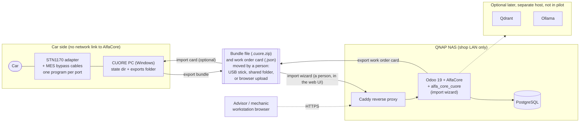

# CUORE to AlfaCore integration spec (decision document)

Status: draft 2, 2026-10-22 (owner decisions of 2026-10-22 applied: car-side CUORE, offline file transfer, no auth work in CUORE). Decision document, not an implementation. It builds on two source files in this folder:

- **MAP** = `ALFACORE_MODEL_MAP.md` (what AlfaCore has today, read from its code).
- **CUORE** = `CUORE_SIDE_CONTRACTS.md` (what CUORE stores, exposes and lacks today).

Citations look like `[MAP 9]` (section 9 of the model map) or `[CUORE 1.7]` (section 1.7 of the contracts file). "Proposed" means nothing exists yet. The spec targets what AlfaCore **actually ships** (the code), not what its architecture corpus describes [MAP 1, 15.4]. The contracts file's Part 2 designs an online outbox, token client and TLS; this spec **supersedes** those parts (CUORE 2.4 rows 2, 3, 7, 8, 9 and 11) with the offline design below. Its data contracts (Part 1) and safety invariants (2.5) still apply.

This file contains no credentials, addresses, hostnames or real VINs, and must stay that way (section 10).

---

## 1. Goals and non-goals

### Goals

| Role | System | Owns |
|---|---|---|
| System of record | **AlfaCore** (Odoo 19 CE) | customers, vehicles, service orders, mechanics, bays, parts, invoicing, customer portal |
| Diagnostic engine | **CUORE** (car-side PC) | talking to the car, readings, evidence, hypotheses and their rules, mechanic plan, safety rules |

1. A service order opened in AlfaCore gives the bay a **work order card** (a file); CUORE diagnoses the car; CUORE exports a **bundle** (a file); a person imports it into AlfaCore, where it attaches to that order, vehicle and invoice.
2. CUORE remains the **source of truth for readings**. AlfaCore holds an immutable-in-practice copy plus the business workflow [CUORE 2.3].
3. The evidence class of every statement (reading, inference, outside literature, owner-attested) survives the trip and is shown in both systems [CUORE 1.13].
4. CUORE has **no network dependency** on AlfaCore: a bay works identically with the NAS up, down or absent.
5. **Pilot scope:** one shop, one marque (Alfa Romeo), one platform (Giorgio), a small number of bays, LAN only on the AlfaCore side.

### Non-goals (pilot)

- **No network link from CUORE to AlfaCore.** No outbound queue, no AlfaCore API calls from CUORE, no JWT client, no TLS client, no token handling in CUORE (owner decision, section 3). `POST /api/v1/scans` and a station ingest endpoint are possible later options only (section 6.3).
- No remote control of CUORE or the adapter from AlfaCore. No "start scan", clear, flash, write or actuation from AlfaCore, ever [CUORE 2.5 items 1, 2, 4].
- No second marque, no multi-location (`alfa_core_multi_loc` is an empty stub [MAP 13]), no internet exposure, no BLE path. The customer PWA/BLE scanner flow of AlfaCore is untouched and coexists [MAP 6].
- No LLM, Qdrant or Ollama in the pilot path. CUORE's bulletin cross-reference is rule-based and stays in CUORE [CUORE 1.12]; AlfaCore's Qdrant client is a stub [MAP 10, 14].
- No customer data in the work order card. No migration of CUORE's portable "cases" into AlfaCore in the pilot.
- No data-model changes inside AlfaCore's existing modules. All additions go in a new connector module (section 6), following AlfaCore's custodianship rule: extend by `_inherit`, never a parallel model [MAP 1].

---

## 2. Topology



Rules the diagram encodes:

- One CUORE per car-side PC, one adapter per CUORE, one program per COM port [CUORE 2.2, 2.3].
- The only link between the two sides is **a file moved by a person**. CUORE never opens a connection to AlfaCore and AlfaCore never opens one to CUORE. This removes the need for an inbound path to the bay PC and an outbound path from it.
- The bundle is the unit of transfer, versioned and self-contained (section 4.3). The work order card is the optional reverse direction (section 4.4).
- Qdrant and Ollama are not on the QNAP: its memory budget has no room for them [CUORE 2.1]. Optional and out of the pilot.
- Exact network details of the shop live in deployment notes outside this repo.

---

## 3. Security posture (owner decision)

CUORE stays as it is: no token, current binding, no authentication work. It runs on the car-side PC and never talks to AlfaCore over the network. Residual risk, stated neutrally: anyone who can reach that PC's port 5000 can use CUORE, including reading VINs and job data and posting to jobs [CUORE 1.14, 2.2]. The owner has accepted this risk (decision of 2026-10-22).

What this posture does and does not change in the rest of the spec:

- No CUORE-side token, TLS, JWT, firewall or launcher work is in the plan. Items 2, 3, 7, 8, 9 and 11 of [CUORE 2.4] are withdrawn for the pilot.
- Exported files contain VINs and diagnostic data. They are customer data and are handled as in section 10 (privacy), not left in shared or public places, and removed from removable media after import.
- The AlfaCore import wizard treats every bundle as **untrusted input** (section 6.4): schema validation, size limits, integrity hashes, no code execution, human confirmation, attribution to the importing user. This is a property of the importer, not CUORE-side security work.
- Bundles are not signed in the pilot. The SHA-256 hashes in the manifest detect corruption and truncation, not tampering.

---

## 4. Identity, idempotency and the file formats

AlfaCore's scan API creates a new session on every POST and has no idempotency key [MAP 9, 15.3]; CUORE's ids are not globally unique [CUORE 1.2]. Both are fixed by identifiers stamped at export and by unique constraints in `alfa_core_cuore`.

### 4.1 Identifiers

| Entity | Today (CUORE) | Proposed | Natural key in AlfaCore |
|---|---|---|---|
| Bundle | none | `bundle_id` (UUIDv4), minted at export | `bundle_id` unique |
| Station | none | `CUORE_STATION_ID`, registered in AlfaCore (`alfa_core_cuore.station`), lowercase slug, one per car-side PC, never reused | `station_id` |
| Scan | `SCAN_YYMMDDHHMM` (minute resolution; collides across PCs and within a minute) | Mint `scan_uuid` (UUIDv4) when a scan or guided session starts; **keep** the legacy `scan_id` as `legacy_scan_id` | `(station_id, scan_uuid)` |
| Guided segment | segments inside one `scan_id` | same `scan_uuid`; segments keyed by `n` | `(station_id, scan_uuid, n)` |
| Observation | no id | Stamp at write time: `obs_id` (UUIDv4), `scan_uuid`, `station_id`. Legacy rows get `obs_id = sha256(station_id + at + kind + canonical json of data)[:16]` at export; never the file line number (the file has been hand-edited) | `(station_id, obs_id)` |
| Job | `uuid4().hex[:12]` | unchanged, always with the station | `(station_id, job_id)` |
| Hypothesis, action | `uuid4().hex[:8]`, unique within a job only | unchanged | `(station_id, job_id, hyp_id)`, `(station_id, job_id, action_id)` |
| Attested row, owner event | unique uuid | unchanged | `(station_id, id)` |
| Bulletin | `id` and `number` as printed | unchanged | `(manufacturer, bulletin_number)`; CUORE `id` kept as `cuore_ref` |
| Vehicle | VIN (may be `""` on Mode 03/06/0A reads) | resolved **at export** (from the scan's VIN read, then the linked order card); an item with an unresolved VIN is listed in the manifest under `unresolved` and is not imported [CUORE 1.2, 2.6 Q3] | VIN, uppercased |
| Work order card | none | `card_id` (UUIDv4), minted by AlfaCore at export | `card_id` |

Stamping `scan_uuid` into every new observation removes the need for the time-window heuristic of `scanlog` and the scan-requirements bridge for new data [CUORE 1.2]; the heuristic stays for exporting old data.

### 4.2 Timestamps

CUORE writes naive local time with no offset [CUORE 1.1]; Odoo stores UTC. The one ambiguous hour at the autumn clock change makes naive local times unrecoverable.

- Going forward CUORE writes offset-aware ISO 8601 (`...+hh:mm`) wherever it writes `at`, `opened_at`, `started`, `event_date` with a time.
- Add `CUORE_TZ` (IANA zone). Legacy naive values are converted with it at export and flagged `tz_assumed: true`; stored values are never rewritten [CUORE 2.4 row 6].
- The manifest has `created_at` with offset and `tz`. AlfaCore keeps the original string (`at_local`) and the UTC value. Because files may travel for days, the wizard shows the bundle's age; it cannot measure clock skew (no network), so NTP on the car-side PC is still advised.

### 4.3 The bundle (`*.cuore.zip`)

One bundle per scan, per job, or per scan plus job. A zip with a manifest and JSON payload files; JSON only, no executable content. Proposed layout:

```
<name>.cuore.zip
  manifest.json
  vehicle.json        identity, module identities, cal IDs
  scans/<scan_uuid>.json      header, segments, coverage, requirements result
  observations/<scan_uuid>.jsonl   raw envelope + data (replayable; unknown kinds kept)
  dtcs/<scan_uuid>.json       DTCs with status bytes, decoded snapshot/extended/freeze frames
  mode06/<scan_uuid>.json
  readiness/<scan_uuid>.json
  evap/<scan_uuid>.json       evap_bundle, if any
  job/<job_id>.json           folded job, hypotheses, evidence refs, actions, attested/owner items
  plan/<job_id>.json          mechanic plan snapshots per hypothesis
  proof/<job_id>.json         proof-of-fix result, if any
  xref/<job_id>.json          bulletin cross-reference result
  media/...                   only if the mechanic ticked "include photos"
```

`manifest.json`:

| Field | Meaning |
|---|---|
| `schema_version` | integer; AlfaCore supports a stated range and refuses outside it |
| `bundle_id` | UUIDv4; the idempotency key of the import |
| `bundle_kind` | `scan`, `job` or `scan_job` |
| `station_id`, `cuore_version` | provenance |
| `created_at`, `tz` | offset-aware creation time and the station's IANA zone |
| `vin` | the single vehicle the bundle is about (a bundle never mixes vehicles) |
| `order_ref` | the work order card the job was opened from (`card_id`, order name), if any |
| `scan_uuids`, `job_keys` | contents summary |
| `finalized` | false when a guided scan is paused or a job is open (a later bundle may supersede) |
| `supersedes` | `bundle_id` of an earlier bundle for the same scan or job, if any |
| `op_count` | per job, monotonic: the number of `jobs.jsonl` ops folded into the snapshot |
| `unresolved` | items left out (for example observations with no resolvable VIN) and why |
| `files` | for each file: path, bytes, SHA-256 |
| `contains` | list of sections present |

Supersession: a later bundle for the same `(station_id, scan_uuid)` or `(station_id, job_id)` updates the earlier import while it is not `finalized`; for jobs the higher `op_count` wins and a lower one is ignored (D4). A finalised scan is never updated; a conflicting re-export is rejected with a visible reason, and a correction is a new scan.

Carried verbatim: `error`, `nrc`, `warning`, `note`, `confidence`, `basis`, `stream`, `from_car` [CUORE 1.3, 1.7]. Unknown observation kinds are kept raw, never dropped.

### 4.4 The work order card (`*.alfaorder.json`, reverse direction, optional)

Exported from the AlfaCore service order form (button "Export work order card"). **Customer-free**: no customer name, phone, email, address or plate.

| Field | Meaning |
|---|---|
| `schema_version`, `card_id`, `created_at`, `tz` | as for bundles |
| `order` | order name/reference and `alfa_service_state` |
| `vehicle` | `vin`, `year`, `make`, `model`, platform code, engine code, trim code, last known mileage (km) |
| `complaint` | the intake complaint text (advisor-edited; must not contain customer identity) |
| `technician` | display name only |
| `bay` | bay code; `requested_station_id` |

CUORE imports it locally (a file operation; validates schema and size; ignores unknown fields; creates a job through the existing job route with `links.alfacore_order = {card_id, order}`; never executes anything from the file). CUORE cross-checks the card's VIN against the VIN read from the car and shows a blocking banner on mismatch (section 8 step 2).

An optional receipt file `*.cuore-receipt.json` (`bundle_id`, `imported_at`, order, counts) can be exported by the AlfaCore wizard; CUORE can import it to mark the export "delivered". Without it, the mechanic marks delivery by hand. CUORE keeps an `exports.jsonl` index (bundle_id, kind, created_at, sha256, status `exported` / `delivered`).

### 4.5 Import idempotency

- `alfa_core_cuore.bundle` stores `bundle_id` (unique), file SHA-256, state (`validated`, `imported`, `superseded`, `voided`, `rejected`), importer, imported-at, counts and the validation log.
- Re-importing the same `bundle_id` is a no-op that reports "already imported on <date> by <user>". Re-importing different content under the same `bundle_id` is rejected.
- Below the bundle, each record carries an `external_key` (unique) from the table in 4.1, so overlapping bundles (for example a scan exported twice) never duplicate rows. A repeat with identical content is ignored; a repeat with different content follows the supersession rules in 4.3.
- All-or-nothing: one bundle is imported in a single transaction; any validation error leaves AlfaCore unchanged.

---

## 5. Field-by-field mapping

Legend: **Direct** = existing AlfaCore field fits. **Extend** = new field on an existing model (via `_inherit` in `alfa_core_cuore`). **New** = new model in `alfa_core_cuore`. **Hold** = not sent in the pilot. All writes are performed by the import wizard's service method, not by `POST /api/v1/scans`.

### 5.1 Vehicle, VIN and module identity (to `alfa_fleet`)

| CUORE source | AlfaCore target | Kind | Notes |
|---|---|---|---|
| `vin` | `alfa_fleet.vehicle.vin` | Direct | ISO 3779 pattern, no I/O/Q, uppercased by the model [MAP 3]. The vehicle must **already exist**; the wizard never creates customers or vehicles in the pilot. |
| catalogue `vehicle.{make, model, year}` | `vehicle.make/model/year` | Direct (read-back) | Comes from AlfaCore via the card, not from the bundle. |
| catalogue `vehicle.engine`, platform key | `vehicle.engine_id`, `platform_id` | Direct | Map CUORE codes to `alfa_fleet.platform.code` (pilot: `giorgio`) and `engine.code` (`GME_2_0T` etc.) [MAP 15.2]; mapping table kept as data (Pattern 6). |
| `market` (catalogue) | none | Hold | No field; add only if a second market appears. |
| Mileage | `vehicle.last_mileage_km`, `scan_session.mileage_at_scan` | Direct | CUORE does not capture odometer today [CUORE 1.4]; the wizard asks the person importing or takes the order intake value. |
| Mode 09 VIN, `module_identity` F190 | cross-check | n/a | Must equal the selected order's VIN or the import is blocked. |
| `module_identity` (F187/F188/F189/F18C/F191/F192/F194/F195), Mode 09 04/06 (calibration IDs, CVN), 08, 0A | `alfa_core_cuore.module_identity` | **New** | Per vehicle, per scan: `ecu`, `bus`, DID, `name`, `ascii`, raw `bytes`, `nrc`, `cal_id`, `cvn`, `scan`. AlfaCore has no field for ECU software versions or calibration IDs [MAP 3, 15.3]. |
| `addresses.json` confirmed target, `bus_confidence` | `module_identity.target`, `address_confirmed` | **New** (info only) | AlfaCore never sends an address back to CUORE [CUORE 2.5 item 3]. |
| `adapter_identity`, `verify_*` (awake, awake_note) | `scan_session` bus fields, `station` adapter fields | Extend | See 5.2. |

### 5.2 Guided scan, DTCs, status bytes, freeze frames, Mode 06, EVAP bundle, scan requirements (to `alfa_core_scanner`)

`POST /api/v1/scans` cannot carry this data and does not fit a shop: it requires the caller to be an active owner of the vehicle and a device paired to that caller and vehicle, creates the session as `uploaded`, is not idempotent, and accepts only parsed `code/status/module/freeze_frame/raw` strings [MAP 9, 6]. The wizard writes the same three AlfaCore models (`scan_session`, `scan_dtc`, `scan_pid`) directly, plus the new ones. The API stays untouched for the customer PWA.

**Session header (`alfa_core_scanner.scan_session`)**

| CUORE | AlfaCore | Kind | Notes |
|---|---|---|---|
| `scan_uuid`, legacy `scan_id` | `external_key` (unique), `legacy_scan_id` | Extend | |
| `bundle_id` | `bundle_id` (M2O `alfa_core_cuore.bundle`) | Extend | Provenance of every imported row. |
| `started` / first observation `at` | `started_at` | Direct | UTC (4.2). |
| last `scan_coverage.at` | `ended_at` | Direct | |
| ECUs that **answered** | `modules_scanned` (CSV) | Direct | Only answered modules. Silent and not-reachable ones go to coverage rows, never into this list. |
| battery voltage (PID 42 or voltage read, if present) | `battery_voltage` | Direct | Null if not read. |
| station adapter | `device_id` | Direct | One `alfa_core_scanner.device` per station adapter (6.1). Mandatory field. |
| `stream` | `stream`, computed `from_car` (true only if it starts with `serial` or `recording(serial`) | Extend | A non-car stream is stored but never shown as a reading [CUORE 1.3]. |
| scan `status` complete / partial / attempt | `cuore_scan_status` | Extend | `partial` and `attempt` scans are **not** counted as completed [CUORE 1.5]. |
| `cable`, `buses_attempted`, per-bus `awake` | `cable_declared`, `buses_attempted`, bus verification flags | Extend | |
| (policy) | `state = uploaded`, `inference_zde = True` | Direct | Set explicitly; AlfaCore has no inheritance code [MAP 6, 15.3]. |
| `guided`, `guided_status`, segments `{n, cable, bus, status, why}` | `alfa_core_cuore.scan_segment` | **New** | Skipped and failed segments are kept with their `why`. |
| `counts {active, history, not_run}` | `count_active`, `count_history`, `count_not_run` | Extend | |

**Coverage (`scan_coverage.coverage[]`)** to `alfa_core_cuore.coverage` (**New**): `bus`, `module`, `category` (`answered`, `silent`, `not_reachable`), `why`, `active`, `history`, `not_run`, `did`. This is how "failure is not clean" survives [CUORE 2.5 item 6]. The latest `scan_coverage` per `scan_uuid` wins [CUORE 1.4].

**DTC rows (`alfa_core_scanner.scan_dtc`)**

| CUORE | AlfaCore | Kind | Notes |
|---|---|---|---|
| `code` `P0456-00` | `dtc_code = P0456` | Direct | Split the failure-type byte. |
| failure-type byte `00` | `failure_type_byte` | Extend | |
| UDS `status` int | `status_byte` (Integer) | Extend | Raw byte, always. |
| `flags` (8 named bits) | eight Booleans, or one JSON field, named as in [CUORE 1.7] | Extend | |
| CUORE classification: active = `status & 0x0D`; history = not active and `status & 0x20` | `dtc_status` active / history | Direct | UDS rows. |
| Mode 03 stored / 07 pending / 0A permanent | `dtc_status` active (confirmed) / pending / permanent | Direct | Plus `source_service` (`obd_03`, `obd_07`, `obd_0a`, `uds_19_02`). |
| ECU, bus | `module_source`, `bus` | Direct / Extend | |
| `raw` | `raw_payload` | Direct | |
| tracked-but-neither-active-nor-history codes (a 19 02 reply lists everything the module tracks, hundreds for the ECM) | **no `scan_dtc` row** | Hold | Counted in `count_not_run`; full list stays in the raw observation. A tracked code is not a fault. A code with only bit 0x40 set is `readiness_only` [CUORE 1.7]. |
| `dtc_detail` snapshot (19 04) | `alfa_core_cuore.dtc_detail_item`, kind `snapshot` | **New** | `record_number`, `did`, `name`, `bytes`, `value`, `unit`, `confidence` (high/medium/low/unknown), `basis`, `undecoded_from`. Null name/value stay null. |
| `dtc_detail` extended (19 06) | `dtc_detail_item`, kind `extended` | **New** | `record_number`, `bytes`, `meaning_guess`, `confidence` (`unverified for FCA`). `meaning_guess` is never shown as fact [CUORE 1.7]. |
| `freeze_frame` (Mode 02) | `dtc_detail_item`, kind `mode02` | **New** | `pid`, `name`, `value`, `unit`. `scan_dtc.freeze_frame_data` (free text) keeps a readable summary for compatibility. |
| `evap_bundle` | its codes' `dtc_detail_item`s, `mode06_result`s and `readiness` for the same scan, plus the raw observation | New (composed) | `not_applicable` when no P044x/P045x/P046x is active. |

**PIDs (`scan_pid`)**: `pids_snapshot` and `pid` observations become rows: `pid_id` = `01` + hex PID (for example `010C`), `pid_name`, `value` (Float), `units`. Non-numeric values go to `raw_payload` with `value` empty.

**Mode 06 (`alfa_core_cuore.mode06_result`, New)**: `scan`, `ecu`, `mid`, `mid_name`, `tid`, `uasid`, `unit`, `value`, `min`, `max`, `passed`, `scaling` (`"unknown"` kept), raw `value/min/max`. `passed` stored as sent. `evap_summary` sentences go to the scan's `summary_notes`. AlfaCore has no Mode 06 concept [MAP 15.3].

**Readiness** to `alfa_core_cuore.readiness`: `since_clear` and `this_drive_cycle` monitor rows (`monitor`, `supported`, `complete`), `mil_on`, `stored_dtc_count`, `evap_verdict`, `drive_cycle_counters`. An `{error}` sub-record is stored as an error, never as "complete" or "clean".

**Scan requirements (`scan_requirements_bridge.check`)** to `alfa_core_cuore.requirement_result` (New): `scan`, `req_id`, `label`, `source`, `state` (`met`, `gap`, `needs_mechanic`, `not_applicable`), `reason`; session header gets `captured`, `required`, `non_car_observations`. `needs_mechanic` rows are never shown as failures [CUORE 1.10].

**Everything else** (`mode09`, `adapter_identity`, `did`, `did_discovery`, `capability`, `slvt_replica`, `live_dtc_change`, `live_alarm`, `clear_evidence`, `actuator_test`, `bus_capture`, `scan`) to `alfa_core_cuore.observation` (New): envelope (`station_id`, `obs_id`, `scan_uuid`, `at_local`, `at_utc`, `kind`, `vin`, `bus`, `cable`, `stream`, `from_car`) plus raw `data` JSON. The replayable store and the landing place for unknown kinds. `bus_capture` is metadata only; the CSV stays on the car-side PC [CUORE 1.4].

### 5.3 Jobs, hypotheses, certainty and evidence labels (to `alfa_core_diagnosis`)

AlfaCore's report model has a bare `confidence` Float that no code computes, a `severity` list, and no hypothesis, evidence or provenance concept; its state machine is a plain Selection with no guards [MAP 7]. CUORE's ledger is richer and its status rules are enforced [CUORE 1.8]. The mapping keeps the ledger intact and hangs the AlfaCore report on top.

| CUORE | AlfaCore | Kind | Notes |
|---|---|---|---|
| Job `{id, vin, opened_at, closed_at, technician, complaint, status, outcome}` | `alfa_core_cuore.job` (key `(station_id, job_id)`) linked to `sale_order_id`, `vehicle_id`, `technician_id` | **New** | `outcome` = `fixed`, `not_fixed`, `deferred`. The fold only produces `open` / `closed`; `verifying` is declared and unused [CUORE 1.8]. `op_count` stored. |
| Job as a whole | one `alfa_core_diagnosis.report` per job (and per baseline scan) | Direct + Extend | `scan_session_id` required (restrict). `state`: `draft` on import, `pending_review` once the job is closed, `reviewed` only by an AlfaCore user. The importer never sets `reviewed` or `delivered`. `technical_summary` receives **template-generated** text (not LLM) with evidence labels; the customer-facing `summary` is written by the advisor. |
| Hypothesis `{id, text, system, status, likelihood, next_test, codes, safety, attested_resolved, confirmed_by/at, deleted, audit[]}` | `alfa_core_cuore.hypothesis` (key `(station_id, job_id, hyp_id)`) | **New** | Soft-deleted hypotheses stay with `deleted = true`; `audit[]` as child rows. |
| Hypothesis `status` open / supported / confirmed / refuted | `hypothesis.status` | New | **Read-only in AlfaCore** (D1). |
| `likelihood` low / med / high / null | `hypothesis.likelihood`, `recommendation.likelihood_label` | New / Extend | **Do not synthesise a number.** `report.confidence` (Float) and `recommendation.confidence` are left unset by the importer; the UI shows the label and the evidence class. If a number is ever required it must come from a documented, versioned mapping table. |
| Evidence ref `{kind, id, label, result, resolved}` for / against | `alfa_core_cuore.evidence_ref` | New | `kind` in code, freeze_frame, actuator, live, inspection, symptom, note, media, dealer, bulletin, feedback, test, observation, measurement. `result` pass / fail / inconclusive / not_possible. Linked to the imported scan or observation when it points at one. |
| **Evidence class** | `evidence_class` on `evidence_ref`, `hypothesis`, `recommendation`, `dtc_detail_item` (hint), and each plan step | New / Extend | Selection `reading`, `inference`, `outside_literature`, `owner_attested` [CUORE 1.13]. Rules below. |
| `recommendation` | `alfa_core_diagnosis.recommendation` | Direct + Extend | `action_type`: inspect, replace_part, service, test_drive, recall_check, monitor, do_not_drive. A `safety` hypothesis maps to `do_not_drive` or `inspect` with `severity = safety_critical`. `related_part_id` only via `alfa_parts.part.find_by_part_number`. |
| `safety`, `attested_resolved` | `hypothesis.safety`, `attested_resolved`; `report.severity` | New / Direct | Attestation wording preserved. |
| Evidence-gate verdict (`POST /api/vehicle/{vin}/verdict`) | `report.cuore_verdict` + criteria | Extend | CONFIRMED only when all four criteria hold [CUORE 1.13]. |
| Attested rows, owner events | `alfa_core_cuore.attested_input` | New | Always `evidence_class = owner_attested`, with `confidence` text (`reported`, `SINGLE-SOURCE (mechanic)`). |

**Evidence-class rules (invariants, section 9):**

1. A class is assigned at the source and travels in the bundle. The importer never assigns a class more trustworthy than the source gave. CUORE mapping: from-car observation = `reading`; hypothesis text, xref reasons, plan `rationale`, `classification_note` = `inference`; bulletin / forum / sibling-engine = `outside_literature` (carry `verified`, `vehicle_scope`); `owner_events`, `attested`, `code_findings.owner`, `attested_resolved` = `owner_attested`.
2. A DTC is **not** a measurement. A code selects the fault tree; it does not convict a part [CUORE 1.13].
3. A conclusion's class is the **weakest** class among its supports; only a reading supports "the car showed X". Views and serialisers show `evidence_class` next to every confidence-like value, including the existing `GET /api/v1/diagnoses/<id>` payload (extended by the connector to add it) and the portal page.
4. Absence of a code is not a reading when the monitor has not run (`evap_verdict`).
5. `confirmed` and `refuted` come from CUORE only (D1). AlfaCore's write guard rejects edits to hypothesis status and evidence.

### 5.4 Mechanic steps and proof-of-fix (to `alfa_core_inspection`, `alfa_service`)

**Steps.** CUORE's mechanic plan is derived on demand and not stored [CUORE 1.9], so the export snapshots it (`plan/<job_id>.json`) for each selected hypothesis. AlfaCore's inspection creates one finding per template item at creation and has no dynamic step model [MAP 8, 15.3]. Approach:

- A published template `CUORE-PLAN` with one catch-all item (publishing refuses a template with no items [MAP 8]). To verify on the pilot instance: whether `finding.template_item_id` is required; if so, all dynamic findings point at the catch-all item.
- One `alfa_core_inspection.inspection` per `(job, hypothesis)` linked to the order, vehicle, bay and technician. It stays **internal**: the connector never calls `action_send_to_customer`, so it never reaches the portal [MAP 12].

| CUORE plan step | AlfaCore `finding` | Notes |
|---|---|---|
| `n` | `step_order` | Order only, **not identity**: `n` renumbers when a step becomes done [CUORE 1.9]. |
| identity | `step_key` = sha256(`hyp_id` + title + source)[:12] | Stable; unique per inspection. |
| `title`, `detail` | `name`, `note` | |
| `kind` precondition, vin_check, read, flash, test, drive_cycle, decide, inspect, record | `step_kind`; `measurement_type` pass_fail (default) or text | |
| `source` | `step_source` | Includes the `OUTSIDE LITERATURE, not a reading from this car:` prefix where CUORE sets it, with `evidence_class = outside_literature`. |
| `bulletins[]`, `tools[]` | `step_bulletins`, `step_tools` | |
| `done`, `done_ref` | `step_done`, `step_done_ref`; `state` not_checked until done | A done process step sets `state = pass` meaning "completed", `step_result = none`. |
| test result on the satisfying action / evidence | `step_result`; `state` pass / fail / warn (inconclusive, not_possible) | The meaning of a test result stays the mechanic's judgment [CUORE 1.8]. |
| (policy) | `remediation_recommended = False` | So `action_apply_to_so` creates no sale lines from diagnostic steps [MAP 8]. Repairs become lines via recommendations. |
| step 1 "never clear codes; no CAN-CH transmit without consent" | preserved verbatim as the first step | |

A later bundle for the same job updates step done-state and results (higher `op_count` wins).

**Proof-of-fix.** CUORE has the pieces: job `verification {readiness_at, codes_returned, verdict}`, `GET /api/live/module/{code}/repair`, the read-only SLVT replica (PASS / FAIL / INCONCLUSIVE), `clear_evidence` before any clear, job `outcome`, and per-code `proof` text [CUORE 1.4, 1.8, 1.11]. AlfaCore has only `quality.check` (state, note) and `campaign.target.serviced` [MAP 15.3]. The export composes `proof/<job_id>.json`; the wizard writes `alfa_core_cuore.proof_of_fix`:

| Field | Meaning |
|---|---|
| `job_id`, `hypothesis_id`, `sale_order_id`, `vehicle_id` | linkage |
| `criteria` | what counts as proof (code finding `proof` or the plan), for example "absent from reads over N drive cycles, status bytes read before any clear" |
| `baseline_scan_id` | scan before repair |
| `clear_evidence_ref`, `clear_at` | the `clear_evidence` observation (captured before the clear), if a clear was done |
| `verification_scan_id` | scan after repair; must have `from_car = true` and `cuore_scan_status = complete` |
| `readiness_at`, `codes_returned`, `drive_cycles` | as read |
| `verdict` | `passed`, `failed`, `inconclusive`; `inconclusive` whenever the monitor has not run |
| `outcome` | `fixed`, `not_fixed`, `deferred` (from the job) |
| `evidence_class` | `reading` only if the verification scan is from-car; otherwise the record cannot be `passed` |

Each `proof_of_fix` creates or updates one `alfa_service.quality.check`; `action_pass()` is allowed only when `verdict = passed` (guard in the connector). `waived` needs a manager and a reason [MAP 5].

### 5.5 TSB catalogue, cross-reference, recalls (to `alfa_tsb`, `alfa_core_campaign`)

The catalogue (141 rows; kinds `tsb`, `recall`, `csn`, `campaign`, `extended_warranty`, `emissions`, `field_report` [CUORE 1.12]) moves by a separate **catalogue bundle** (`bundle_kind = catalogue`, same wrapper, same idempotency) exported rarely, not per job. The per-job `xref/` section references rows by `(manufacturer, bulletin_number)`.

| CUORE row | AlfaCore target | Notes |
|---|---|---|
| `kind = tsb` | `alfa_tsb.tsb` | `number` to `bulletin_number` (unique with `manufacturer`), `title` to `name`, `date` to `issued_date`, `summary`, `condition` to `symptoms`, `remedy` to `procedure`, first link to `source_url`, `supersedes` to `supersedes_id`, `dtcs[]` joined to `related_dtc_codes`, fitment to `fits_*`. |
| `kind = recall` / `emissions` | `alfa_core_campaign.campaign`, `safety_recall` / `emissions_recall` | `nhtsa_id` to `source = nhtsa`; `transport_canada_id` to `source = transport_canada` (no poller exists; this import is the only Canadian path [MAP 11]); upsert on `(source, source_id)` so the daily NHTSA poll and this import do not duplicate. |
| `csn`, `campaign` | `campaign`, `service_campaign` | |
| `extended_warranty` | `campaign`, `warranty_extension` | |
| `field_report`, `vehicle_scope = sibling_engine` | **Hold** in the pilot | Never verified and sibling-engine only; if imported later: `outside_literature`, `verified = false`, state `draft`, out of vehicle-facing recall lists. |
| `applies` (yes / no / vin_check), `verified`, `vehicle_scope`, `systems[]`, `repair_implied`, `components[]`, `symptoms[]`, `depends_on_systems[]` | `cuore_*` fields on `alfa_tsb.tsb` | Extend. `applies` and `verified` decide how much weight a bulletin may have [CUORE 1.12]. |
| `state` | `published` only when `verified`; else `draft` | **Never set `chunked` or `indexed`**: the Qdrant client is a stub [MAP 10, 15.4]. |

**Cross-reference (`tsb_xref_bridge.xref`)** stays computed in CUORE (rules, `reason`, score, flags, analogues). AlfaCore stores the per-job result as `alfa_core_cuore.bulletin_link` (New): `job`, `tsb`, `relation_type` and `relation` as in [CUORE 1.12] (`explains`, `historical`, `same_system`, `dependent_system`, `supports`, `weakens`, `already_applied`, `did_not_resolve`, `ruled_out_by_inspection`, `candidate`), `reason`, `score`, `flags` (`not_applicable`, `other_model`, `year_doubt`), `evidence_class` (`inference`; `outside_literature` for analogues). A `suggestion` is stored as a suggestion only. AlfaCore has no DTC-to-TSB relation beyond the comma string [MAP 15.2] and no dependency on vector search.

### 5.6 Service order linkage (to `alfa_service`)

| Link | AlfaCore | Notes |
|---|---|---|
| Order | `sale.order` (`alfa_vehicle_id`, `alfa_service_state`, `alfa_bay_id`, `alfa_technician_id`) [MAP 5] | The service order **is** a `sale.order` extension, not `alfa_service.order`. |
| Order to bay | `alfa_service.bay` to `station` (1:1) | A station is registered against exactly one bay. |
| Order to job | `job.sale_order_id`; `sale.order.cuore_job_ids`, `cuore_bundle_ids` | New fields on `sale.order`. |
| Technician | `hr.employee` | CUORE's `technician` is free text; the card supplies the display name. |
| Complaint | `sale.order.cuore_complaint` (New Text) | Goes onto the card; feeds the job's `complaint`. |
| Parts | `sale.order.line` with `alfa_parts.part` (product) | Chosen by a person in AlfaCore; CUORE only suggests (`repair_implied`). |
| State changes | `action_advance_service_state` | Validates nothing today [MAP 5]; the connector adds guards (6.5). |
| Invoice and portal | standard Odoo invoice; `/my/diagnoses`, `/my/inspections` | Portal lists only `reviewed` / `delivered` diagnoses [MAP 12]. |

---

## 6. Gaps and the new Odoo module `alfa_core_cuore`

### 6.1 What it adds

One module, depends on `alfa_core`, `alfa_fleet`, `alfa_service`, `alfa_parts`, `alfa_core_scanner`, `alfa_core_diagnosis`, `alfa_core_inspection`, `hr`. It does **not** depend on `alfa_core_app_api`: the offline design does not use the REST API, the JWT secret manager or the rate limiter. The catalogue half (`alfa_tsb`, `alfa_core_campaign`) goes in an optional second module `alfa_core_cuore_catalogue` so the base module does not pull in `alfa_tsb`'s `qdrant_client` Python dependency [MAP 10] on a NAS that does not run Qdrant.

**Extensions by `_inherit` (no parallel models):**

| Model | Added |
|---|---|
| `alfa_core_scanner.device` | `model_name` gains `cuore_stn` ("Wired bay adapter, STN1170"); `transport` (serial_usb), `station_id`, `adapter_fw`, `adapter_id_string`. A wired adapter has no pairing step and no RSSI; the connector never requires `partner_id` / `vehicle_id` on such a device [MAP 6]. |
| `alfa_core_scanner.scan_session` | `external_key` (unique), `legacy_scan_id`, `bundle_id`, `station_id`, `stream`, `from_car`, `cuore_scan_status`, `cable_declared`, `buses_attempted`, counts, `captured` / `required`, `finalized`, `at_local`, `tz_assumed` |
| `alfa_core_scanner.scan_dtc` | `failure_type_byte`, `status_byte`, flag Booleans, `source_service`, `bus`, `ecu_address`, `external_key` |
| `alfa_core_diagnosis.report` / `.recommendation` | `job_id`, `evidence_class`, `likelihood_label`, `cuore_verdict`, `external_key` |
| `alfa_core_inspection.finding` | the `step_*` fields of 5.4, `evidence_class` |
| `alfa_tsb.tsb` (catalogue module) | the `cuore_*` fields of 5.5 |
| `sale.order` | `cuore_job_ids`, `cuore_bundle_ids`, `cuore_complaint`, `cuore_proof_required`, `cuore_card_id` |

**New models:** `bundle`, `station`, `observation`, `scan_segment`, `coverage`, `dtc_detail_item`, `mode06_result`, `readiness`, `requirement_result`, `module_identity`, `job`, `hypothesis`, `evidence_ref`, `attested_input`, `bulletin_link`, `proof_of_fix`.

**Views:** a CUORE tab on the scan session (header, segments, coverage table, DTC table with status-bit flags, Mode 06, readiness, requirements, raw observations); a job form (hypotheses with evidence-class badges, evidence refs, actions ordered by `effective_date`, plan steps, proof-of-fix); a bundle list (state, importer, counts, validation log); a station list; on the order form, buttons "Export work order card" and "Import CUORE bundle". Every evidence-bearing list shows the evidence class and `from_car` as a visible badge.

### 6.2 Security groups

Built on AlfaCore's vocabulary `group_user < group_advisor < group_manager` [MAP 1]:

| New group | Implies | Can |
|---|---|---|
| `alfa_core_cuore.group_mechanic` | `alfa_core.group_user` | Run the import wizard for orders in their bay; read jobs, hypotheses, scans and plan steps; mark inspection steps done in AlfaCore. Read-only on all CUORE-sourced readings. Cannot edit hypothesis status, evidence or scans. |
| `alfa_core_cuore.group_service_advisor` | `alfa_core.group_advisor`, mechanic | Create and confirm service orders, export work order cards, run imports for any order, review and edit report summaries, choose parts, send to customer. Cannot edit CUORE readings. |
| `alfa_core_cuore.group_manager` | `alfa_core.group_manager`, advisor | Register stations, void a bundle import (rows marked `voided`, not deleted, with a reason), waive quality checks, override the release guard with a reason. |

CSV ACLs are explicit per model, as in AlfaCore [MAP 1]. Record rules: mechanics see only records of orders assigned to their bay or to themselves. There is no service account and no API token in the pilot.

### 6.3 The import wizard and export action (no REST dependency)

- **Import wizard** (`alfa_core_cuore.import.wizard`, a transient model): (1) choose the service order (or accept the manifest's `order_ref`) and upload the `.cuore.zip` in the browser; (2) **validation report** (below); (3) **dry-run preview** with counts per model and the list of records that would be created, updated, ignored as duplicates, or rejected; (4) the person confirms; (5) result with links and an optional receipt file. Nothing is written before step 4. Import runs in one transaction, attributed to the user.
- **Export work order card** (button on the order): writes the `*.alfaorder.json` of 4.4 for download.
- **Service method.** The wizard calls a single method, `import_bundle(payload, order, user)`. A later REST route, or `POST /api/v1/scans` for the customer app, could call the same method; that is a possible later option and not part of the pilot. The REST surface is not relied on: only five `/api/v1` routes exist and the planned wider surface (refresh, pairing, heartbeat, scan status) is not implemented, and the jsonrpc/HTTP behaviour of the existing routes is unverified [MAP 9].

### 6.4 Validation (the bundle is untrusted input)

1. Zip safety: size cap on the archive and on each member, member count cap, no absolute or parent paths, no symlinks, JSON / JSONL / known media types only; never extracted to disk outside a temp dir; nothing is executed or evaluated.
2. `manifest.json` present; `schema_version` within the supported range (else "this module version cannot read schema N"); every file listed with a matching SHA-256 and size; no unlisted files.
3. JSON validated against a published schema per section; unknown fields tolerated and kept in raw; unknown observation kinds kept raw.
4. `bundle_id` not already imported (else "already imported"); `supersedes` consistent.
5. `station_id` registered and active; the VIN valid (ISO 3779) and an existing `alfa_fleet.vehicle`; **VIN equals the selected order's VIN** (hard stop on mismatch); `unresolved` items listed to the user.
6. Timestamps parse and carry offsets (or `tz_assumed` is set); an `at` in the future or a bundle older than a configurable number of days is flagged, not blocked.
7. Rules re-checked server-side on the data: no hypothesis `confirmed` without a recorded pass/fail test and with unresolved evidence against it (a violating ledger is a warning shown to the user, since CUORE is the authority, and is recorded); a class value outside the four allowed values is rejected; a non-car stream can never produce `evidence_class = reading`.
8. A bundle containing anything command-like (write services, clear, actuation requests) in a field that is not a recorded observation is rejected (I1).

### 6.5 Dependencies on stubs and gaps (target what exists)

| AlfaCore gap | Effect on this design | What the connector does |
|---|---|---|
| REST API: only 5 of the planned endpoints; scan API needs an owner partner and a paired device; not idempotent; no `session_uuid` [MAP 9, 15.3] | Unusable for a shop and not needed | Import wizard writes the models directly; REST left as a later option. |
| Immutability is a convention only: sessions, published templates, reports have no write / unlink guard [MAP 6, 8, 15.4] | Readings could be edited in the Odoo UI | `write` / `unlink` guards in the connector on CUORE-sourced rows (sessions, DTCs, Mode 06, observations, jobs, hypotheses, bundles): only the importer (context flag) may write, and only while `finalized = False`. Managers cannot edit a reading; correction means a new scan and bundle; a bad import is voided, not edited. |
| Qdrant client is a stub; `indexed` is meaningless | No RAG | CUORE-side xref only; do not set `indexed`. |
| Report `confidence` never computed; state machine unguarded [MAP 7] | Nothing to inherit | Evidence class and label (5.3); the importer sets state only to `draft` / `pending_review`. |
| `action_advance_service_state` validates nothing [MAP 5] | Orders can skip proof | Release guard below. |
| No ECU calibration / CVN field, no Mode 06, no UDS status bits, no bus / cable fields, no step model [MAP 15.3] | The data has no home | New models and fields (6.1). |
| `scan_dtc.dtc_code` is a free Char, not the DTC library [MAP 6] | No occurrence counts | Out of scope for the pilot. |
| `inference_zde` is not inherited by code [MAP 6, 7] | Privacy flag could be wrong | Importer sets `True` on every record it creates. |
| Transport Canada recalls have no poller [MAP 11] | Canadian recalls are manual | Catalogue bundle (5.5). |
| VIN decode (vPIC) is a stub [MAP 3] | None | CUORE reads the VIN from the car. |
| Smoke suite partial; manifests track code not docs [MAP 1] | Install risk | Pilot instance gets a smoke run before install (phase 1). |

### 6.6 Guards in the connector

- Finalised scans and jobs are immutable (6.5). A guided scan updates per bundle until its session `status` is `done` or `abandoned`, then `finalized = True` [CUORE 1.6].
- Hypothesis status changes only through import (D1). If D1 is reversed, the server must re-implement the rule [CUORE 1.8]: open to supported to confirmed; any to refuted; `confirmed` needs a recorded pass/fail test and no unresolved evidence against; no return to open. A plain field write would bypass it.
- Release guard: an order with a CUORE job cannot move to `ready_for_pickup` or `closed` while (a) a `safety` hypothesis exists that is neither `attested_resolved` nor resolved, or (b) `cuore_proof_required` and there is no `proof_of_fix` with `verdict = passed` and `outcome = fixed` (a `deferred` or `not_fixed` outcome needs an advisor-recorded decision). A manager can override with a logged reason. CUORE only advises and records [CUORE 1.8]; this guard is AlfaCore's added control (D5).

---

## 7. CUORE-side work

Everything here is local to the car-side PC. None of it exists today. The export reads the stores and writes only into an `exports/` folder; it never opens the serial port and never changes a record [CUORE 2.5 items 8, 9].

| # | Work | Design |
|---|---|---|
| C1 | **Config** | `CUORE_STATION_ID`, `CUORE_TZ`, export folder (default `<state>\exports`). No URLs, no secrets, no credentials. |
| C2 | **Identity stamping** | `scan_uuid`, `obs_id`, `station_id`, offset-aware timestamps in the writers (`fullscan`, `store`, `jobs`). Additive; old readers ignore the extra keys. |
| C3 | **Export bundle** | Builder that assembles the layout of 4.3 from `observations.jsonl`, `jobs.jsonl`, `fullscan_*`, attested / owner files, the plan, the scan-requirements result, proof composition and the xref, for one scan, one job, or both. Resolves VINs, converts legacy naive times with `CUORE_TZ`, computes hashes, writes the zip atomically (temp file then rename), records it in `exports.jsonl`. Allowed while a guided scan is paused: `finalized = false`. |
| C4 | **"Export to AlfaCore" action** | A button per scan and per job in the CUORE UI (and an `/api` route used by that button) that builds the bundle, shows its path, size, contents list and warnings (unresolved VINs, partial scan, non-car streams present), and offers "open folder". Photos only with an explicit tick. A pre-export checklist shows "scan n of 10 complete" status honestly [CUORE 1.5]. |
| C5 | **Import work order card** | Local validation, job creation through the existing route, VIN cross-check against the car's VIN, banner on mismatch. A card never causes any adapter traffic. |
| C6 | **Plan and proof snapshots** | Snapshot the derived mechanic plan per selected hypothesis; compose `proof/<job_id>.json` from job verification, readiness, the module `repair` read, the SLVT replica and the pre-clear evidence reference. |
| C7 | **Delivery tracking** | `exports.jsonl` status `exported` / `delivered`; optional receipt import; the UI lists exports not yet delivered. |
| C8 | **Back-fill** | A one-off export of existing history in bundles with derived `obs_id` and `tz_assumed`, dry-run first, only for vehicles that exist in AlfaCore. |
| C9 | **Backups** | State dir including `exports/` copied nightly to a NAS share with versioned retention; restore tested [CUORE 2.4 row 10]. `audit.jsonl` is not exported. |
| C10 | **Schema + fixtures** | A published JSON Schema per bundle section, with **synthetic** fixtures (synthetic VINs only) shared by CUORE's export tests and the AlfaCore module's import tests so both sides stay in step. |

---

## 8. Pilot flow end to end (by file)

Decisions assumed: D1 (CUORE owns hypothesis status), D2 (file transfer both ways), D4 (folded job snapshots with monotonic `op_count`). See section 11.

| # | Step | What happens | Acceptance criteria |
|---|---|---|---|
| 1 | **Order opened** (AlfaCore) | Advisor creates the service order for an existing vehicle, assigns bay and technician, records the complaint, state `scheduled` or `in_progress`, and exports the work order card. | The VIN passes the ISO 3779 check; the bay maps to a registered, active station; the card contains no customer identity (a test inspects the file); `card_id` recorded on the order. |
| 2 | **Card to CUORE** | A person carries the card to the car-side PC; the mechanic imports it; CUORE opens a job linked to the order. | Job carries the order reference. After CUORE's first VIN read from the car, a **mismatch with the card's VIN stops the flow** with a visible banner and blocks exporting a bundle for that order. Works with no network at all. Skipping the card (a manually opened job) is allowed; the wizard then asks for the order at import. |
| 3 | **Guided scan** | Existing guided scan: CAN-C, blue A5 (CAN-IHS), grey A6 (CAN-CH) with physical confirmation, closing CAN-C re-verify. | One `scan_uuid`; MES interlock respected; every segment recorded including skipped or failed with `why`; status complete / partial / attempt per the CUORE rule; no clearing or writing occurs. |
| 4 | **Export and carry** | Mechanic presses "Export to AlfaCore" (per segment if wanted; final export at `done` or `abandoned`), carries the zip. | Bundle opens, hashes match; manifest has `bundle_id`, `station_id`, tz-aware `created_at`; `finalized` set correctly; unresolved VIN items listed; exporting twice produces distinct `bundle_id`s that import without duplicates. |
| 5 | **Import** (AlfaCore) | Mechanic or advisor runs the wizard on the order. | Validation report clean or with explicit warnings; dry-run counts match the bundle; a second import of the same file says "already imported" and changes nothing; a bundle with a corrupted file, wrong schema version, VIN mismatch or unregistered station is refused with a reason and AlfaCore is unchanged; `from_car` and `stream` correct; `partial` / `attempt` scans are not counted complete; tracked-only codes are not shown as faults; silent modules show "no answer", never "no codes"; UTC and `at_local` both present. |
| 6 | **Job, hypotheses, evidence** | Mechanic works the ledger in CUORE; a job bundle is exported and imported (again, later, as it evolves). | AlfaCore shows each hypothesis with status, likelihood label, evidence refs and **evidence-class badges**; AlfaCore users cannot change hypothesis status or evidence; a conclusion resting only on inference, literature or attestation displays that; a higher-`op_count` re-import updates, a lower one is ignored; the report is `pending_review` and invisible in the portal until an advisor marks it reviewed. |
| 7 | **Mechanic steps to inspection lines** | The plan snapshot becomes an internal inspection. | Lines present with order, kind, source and class; outside-literature steps carry the label; step 1 keeps the never-clear / CAN-CH wording; done-state and test results round-trip on later bundles; no sale lines are created from steps; the inspection is invisible to the customer. |
| 8 | **Parts** | Advisor picks parts for `replace_part` recommendations via `alfa_parts` canonical numbers; the order advances through parts states. | `find_by_part_number` used (no duplicate parts); nothing is ordered automatically from CUORE output; order lines match approved recommendations. |
| 9 | **Repair** | Mechanic performs the repair; CUORE records `repair` / `part` actions with `event_date`. A clear, if any, is a local CUORE procedure with typed consent. | Actions ordered by `effective_date` after import; every clear has its pre-clear `clear_evidence` observation; AlfaCore offers no clear, flash, write or scan-trigger control. |
| 10 | **Proof-of-fix** | Post-repair scan(s) per the criteria; job closed `fixed`, `not_fixed` or `deferred`; a bundle with `proof/` is exported and imported. | `proof_of_fix` references a from-car, complete verification scan; `passed` only if criteria are met on readings; monitor-not-run gives `inconclusive`; the quality check passes only with `passed`; `not_fixed` returns the order to `in_progress` and keeps history; the evidence-gate verdict is recorded. |
| 11 | **Close, invoice, portal** | Order advances to `ready_for_pickup`, `picked_up`, `closed`; standard invoice; advisor-reviewed report delivered on the portal. | Release guard satisfied or overridden with a logged reason; invoice reconciles to approved lines; the portal shows only `reviewed` / `delivered` reports with their evidence class; no raw payloads or internal steps are visible; no reading can be deleted. |

Acceptance also includes a **no-network drill**: run steps 2 to 4 with the NAS powered off and with no network cable on the car-side PC, then complete steps 5 to 11 later, and a **duplicate drill**: import every bundle twice, in reversed order, and compare counts.

---

## 9. Safety invariants that must survive integration

Enforced in CUORE today [CUORE 2.5]. The integration must not weaken or bypass them or offer a route around them. Each has a test.

| # | Invariant | Integration consequence | Test |
|---|---|---|---|
| I1 | **No clearing without consent.** UDS 0x14 only via the local typed `CLEAR <MODULE>` procedure; evidence captured first. | AlfaCore has no route, button, queue or scheduler for clear / flash / write / actuate. Neither the card nor the bundle can carry a command; the wizard rejects command-like content (6.4 rule 8); CUORE's card import ignores any such field. | Search the module for command-like routes; feed command-shaped content to both importers and see it rejected or ignored. |
| I2 | **Read-only by construction.** Write-class services blocked on the read path; no FEPS / programming voltage. | Export and card import are pure file operations and never open the serial port. | Export and import work with the COM port absent or held by another program. |
| I3 | **Confirmed bitrates only.** 500 / 125 / 500 kbps with `confirmed` confidence; cable protocol enforced before any frame leaves. | The card has no bitrate, address or bus setting; `module_identity.target` is informational. | The card schema has no such fields; CUORE import ignores them if present. |
| I4 | **CAN-CH confirmation.** Brakes, airbags, steering need explicit physical confirmation. | A card never starts a scan; scans happen only by the mechanic in CUORE. | No code path from the card import to adapter traffic. |
| I5 | **Never transmit on broadcast ids.** All requests go to confirmed targets only. The contracts file keeps this under the bus / cable protocol enforcement rather than as its own numbered item, so confirm the exact enforcement point in `safety.py` / `buses.py` before writing the test. | Export and card import add no transmit path. | Static test: the export and card-import modules import nothing from the adapter layer. |
| I6 | **Readings-only conclusions.** Only a from-car reading supports "the car showed X"; a DTC is not a measurement; the evidence gate and hypothesis rules hold. | Evidence class travels in the bundle and appears in every view and API response; the importer never promotes a class; `confirmed` only from CUORE. | Attempt to change a class or status via the Odoo UI / ORM is rejected; a non-car stream cannot produce `reading`. |
| I7 | **Owner statements labelled.** | Owner events, attested inputs and `attested_resolved` are always `owner_attested` and shown with their `confidence` wording. | A job with only attested evidence never renders as "confirmed by reading". |
| I8 | **Failures are not clean.** Error, NRC, silence are never "no codes". | Coverage rows and `error` / `nrc` / `warning` preserved and displayed; a scan with no CAN-C answer is `attempt`. | Import a silent-bus fixture; the UI shows "no answer". |
| I9 | **Bystander discipline.** Re-plugging manufactures bystander codes. | AlfaCore shows the CAN-C first / last diff and bystander flags, not only the final list. | A fixture with an intermediate-only code renders as likely bystander. |
| I10 | **One program per adapter; export never blocks or alters a scan.** | Export is a reader; a full disk or failed write leaves the stores untouched. | Export during a guided scan pause and with a full export disk: stores unchanged, scan unaffected. |
| I11 | **Safety jobs surfaced.** `safety` and not `attested_resolved` keeps a job on top and is surfaced at release. | AlfaCore keeps both flags and the guard of 6.6. | An order with an open safety hypothesis cannot be released without an override. |
| I12 | **Confirmed addresses only.** | Only `addresses.json` confirmed targets are used; AlfaCore cannot supply addresses. | See I3. |

---

## 10. Licensing, ownership and privacy

### Licensing and ownership (decision needed before any code moves)

- AlfaCore: public repository, Odoo 19 CE modules, **LGPL-3.0-only**, copyright REAL Partners Ltd. / OdooIQ [MAP header].
- CUORE (this repository): **no `LICENSE` file**. Without one, default copyright applies: nobody else may use, copy or modify it, and publishing it publicly does not grant that right.
- `alfa_core_cuore` extends AlfaCore models by inheritance, so it is a derivative of LGPL code in the practical sense of the licence's linking rules. This spec is not legal advice; confirm with counsel.

Options (neutral; the choice is the owner's):

| Option | Effect |
|---|---|
| A. Connector module lives in the AlfaCore repository under LGPL-3.0; CUORE stays separate | Cleanest licence story for the module; needs agreement with the AlfaCore copyright holders to accept it; CUORE is not relicensed. |
| B. Connector module in its own repository under LGPL-3.0 (or a compatible licence) | Independent maintenance; still LGPL-bound on the Odoo side; CUORE unaffected. |
| C. Connector kept private and deployed by the owner only | No publication, no outside contributors; the same licence terms still apply on distribution. |

The two systems share no code at runtime: the bundle schema and fixtures are the only shared artifact (C10), so its licence also needs a choice (it can be published separately, for example as documentation under a permissive licence). Decide **before** code moves between repositories: (1) a licence for CUORE or a decision to stay unlicensed and private, (2) where the connector lives and under which licence, (3) who owns the connector's copyright, (4) whether CUORE's data files (TSB catalogue, DID tables, scan requirements) may be redistributed inside catalogue bundles, since several rows quote third-party bulletin text. CUORE-side work (tasks 1 and 3 of section 11) stays in this repository and does not move code, so it is not blocked by the decision; the Odoo module (task 2) is.

### Privacy

- **Customer data (VINs, names, plates, photos, job history) lives only in deployed systems.** Never in either public repository, fixtures, tests, docs, screenshots or commit messages. Canadian privacy law applies to customer data (PIPEDA); AlfaCore carries consent-version fields restricted to a privacy-officer group [MAP 2].
- **Bundles and cards are customer data in transit.** They contain VINs and diagnostic history. The work order card is customer-free by design. Bundles are written to the exports folder, moved by a person, and the removable copy is deleted after import; the wizard stores the file hash, not necessarily the file. Photos are excluded unless ticked.
- **Finding, action needed regardless of the integration:** a read-only scan of this repository found VIN-shaped strings matching an Alfa Romeo pattern in 311 files (defaults in code such as `cuore/live/capabilities.py` and `cuore/services/scan_requirements_bridge.py`, the data files `cuore/data/tsb_catalogue.json` and `cuore/data/scan_requirements.json`, tests, and archived reviews). The contracts file notes that the catalogue header and the scan-requirements file carry a vehicle VIN and a default VIN [CUORE 1.10, 1.12]. If any is a real vehicle's VIN, it must be removed from the working tree and from history before the repository stays public (or the repository made private), replaced by synthetic VINs in fixtures and by configuration in code. Add a pre-commit and CI check for the ISO 3779 pattern in tracked files, with an allow-list of synthetic test VINs. This is repository hygiene, separate from the owner's decision on CUORE authentication (section 3).
- `inference_zde = True` on every record the connector creates; no cloud inference on shop data [MAP 2, 15.1].
- Retention, to decide: how long AlfaCore keeps raw observations (D6); photos only by explicit tick; `audit.jsonl` is never exported.
- Logs and the wizard's validation log must not contain full payloads.

---

## 11. Decisions, phased plan, first three tasks

### Open decisions

| ID | Decision | Default proposed here |
|---|---|---|
| D1 | Who changes hypothesis status / evidence after import [CUORE 2.6 Q1] | CUORE only; AlfaCore is a read-only copy |
| D2 | Transfer path [CUORE 2.6 Q2] | Files both ways (bundle to AlfaCore, optional card to CUORE); no network link; API only as a later option |
| D3 | VIN resolution of untagged observations [Q3] | At export, on the CUORE side |
| D4 | Bundle shape [Q4] | Observations raw (replayable) plus folded job snapshots with a monotonic `op_count`; no replay of `jobs.jsonl` on the NAS |
| D5 | Release guard strictness in AlfaCore (6.6) | Block, with manager override and logged reason |
| D6 | Raw observation retention; photos [Q6] | Keep raw observations for the life of the order plus the warranty period; photos only by explicit tick |
| D7 | Licensing and ownership (section 10) | Owner's choice; blocks moving code between repositories |
| D8 | Time-zone and clock policy [Q7] | Offset-aware stamps going forward; NTP advised |
| D9 | Where Qdrant / Ollama run, if wanted [Q5] | Not in the pilot; separate host if later |
| D10 | Bundle signing | Not in the pilot (integrity hashes only); revisit if bundles ever cross an untrusted channel |
| D11 | Transfer medium (USB, shared folder, browser upload) | Any; the format is the same; a watched drop-folder that imports without a person is **not** part of the pilot |

### Phases (effort: S = up to 2 days, M = 3 to 8 days, L = more than a week)

| Phase | Content | Effort |
|---|---|---|
| 0. Hygiene | Record the security posture (section 3); VIN scrub and scanner for the public repository (section 10); decisions D1 to D11; licence (D7) | M |
| 1. Bundle schema and CUORE export | Schema and synthetic fixtures (C10); identity stamping (C2); export builder and button (C3, C4, C6); `exports.jsonl` (C7) | M to L |
| 2. `alfa_core_cuore` import | Models, ACLs, groups, validation, wizard, immutability guards, scan / DTC / Mode 06 / readiness / coverage / identity import; smoke run on a throwaway AlfaCore instance | L |
| 3. Diagnosis and steps | Jobs, hypotheses, evidence classes, reports, plan to inspection lines, views, serialiser extension for the class | L |
| 4. Orders and cards | Work order card export (AlfaCore) and import (CUORE, C5), bay and station mapping, order linkage, parts flow | M |
| 5. Proof and release | `proof_of_fix`, quality-check linkage, release guard, order close, invoice and portal check | M |
| 6. Catalogue | Catalogue bundle and import (`alfa_core_cuore_catalogue`), xref storage | M |
| 7. Pilot dry run | End-to-end by file with the no-network and duplicate drills (section 8); back-fill (C8) only afterwards | M |
| Later options | REST route or `POST /api/v1/scans` calling the same `import_bundle` method; a receipt loop; bundle signing | not scheduled |

### First three tasks

1. **Export bundle schema and the CUORE export button (M to L).** Define the manifest and section schemas (section 4.3), write synthetic fixtures, add identity stamping (`station_id`, `scan_uuid`, `obs_id`, offset-aware timestamps) and the "Export to AlfaCore" action. Tests: two scans in the same minute no longer collide; legacy data exports with `tz_assumed`; export never touches the serial port or the stores. CUORE repository only.
2. **`alfa_core_cuore` import wizard (L).** Station and bundle models, validation (6.4), dry-run preview, idempotency on `bundle_id`, mapping of scans, DTCs with status bytes, freeze frames, Mode 06, readiness, coverage and requirements into `alfa_core_scanner` and the new models, immutability guards. Tested with the task 1 fixtures on a throwaway AlfaCore instance. Needs the licence and location decision (D7) first.
3. **Pilot flow by file (M).** Work order card export and import, job and hypothesis import, plan to inspection lines, proof-of-fix and the release guard, then the section 8 acceptance run including the no-network and duplicate drills.
