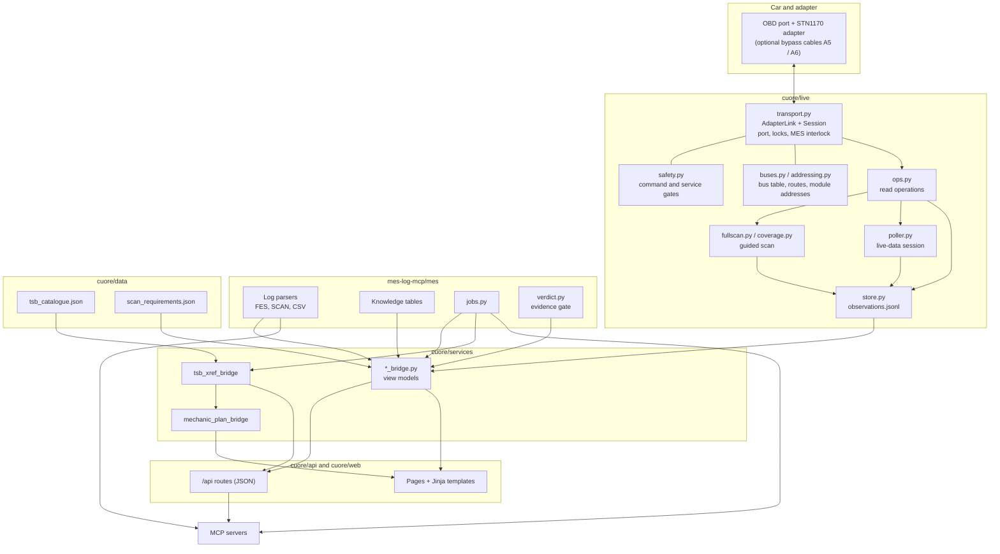

# Architecture

This page is a summary. The full description, written against the code as it stands, is [docs/ARCHITECTURE.md](https://github.com/dangelojohn/CUORE/blob/main/docs/ARCHITECTURE.md); a generated, longer version is in [docs/handbook/02-architecture.md](https://github.com/dangelojohn/CUORE/blob/main/docs/handbook/02-architecture.md).

## Three programs

| Program | Directory | Role |
|---|---|---|
| CUORE web app | `cuore/` | FastAPI application. JSON API under `/api`, server-rendered pages everywhere else. **Owns the adapter.** |
| MES log library and MCP server | `mes-log-mcp/` | `mes/` is the analysis library (standard library only). `server.py` exposes it as MCP tools. |
| Live-link MCP server | `obd2-mcp/` | MCP tools for the adapter. Reads are HTTP calls to the running web app; it runs the same code in process only if the app cannot be reached. |

Dependency direction: `cuore` imports `mes`; `mes` never imports `cuore`. `cuore/services/mes_bridge.py` is the one module that imports `mes` for log analysis; every other `*_bridge.py` wraps one `mes` submodule or one `cuore.live` module. Pages and API routes both call a bridge, so the HTML and the JSON cannot disagree.

## Layers

Reading from the car upward:

1. **Transport** (`transport.py`). `AdapterLink` is the only object that opens the serial port. Each operation opens the port, works and closes it.
2. **Buses and addressing** (`buses.py`, `addressing.py`, `framing.py`, `obd.py`, `uds.py`). Pure data and pure parsers: the buses, the cable routes, module addresses with a confidence grade, the data-identifier catalogue, ISO-TP and J1979 decoding.
3. **Ops** (`ops.py`). The operations both surfaces call. Every function returns a plain dictionary naming the bus and cable used.
4. **Full scan and guided scan** (`fullscan.py`, `coverage.py`). Sequencing on top of ops.
5. **Observation store** (`store.py`). Every read is appended to `observations.jsonl`: the only live-data input to the evidence gate.
6. **Bridges** (`cuore/services/*_bridge.py`). Turn stores and libraries into the view model a page or API route needs. Optional dependencies are imported lazily so a missing module degrades one page, not the app.
7. **Routes and templates.** `/api/*` returns JSON and mirrors the MCP tools; pages are Jinja templates with no build step and no single-page-app bundle. Forms work without JavaScript.

Two pipelines run beside the live path: **MES logs to jobs and hypotheses** (parse FES/SCAN/CSV, derive the dossier, fault trees and evidence gate, keep the append-only job store) and **bulletin catalogue to cross-reference to mechanic steps** (see [[TSB Layer and Cross-Reference|TSB-Layer-and-Cross-Reference]] and [[Jobs, Hypotheses and Mechanic Steps|Jobs-Hypotheses-and-Mechanic-Steps]]).

## Profiles

`cuore/profiles.py` defines `bench` (this PC: log corpus, every analysis, the adapter) and `drive` (reserved for an in-car node). Clients ask `/api/capabilities` what the host can do. Only `bench` is implemented.

## Data files shipped with the code

| File | Content |
|---|---|
| `cuore/data/tsb_catalogue.json` | 140 rows: 99 for the reference model plus 41 sibling-engine analogues; schema inside the file. |
| `cuore/data/scan_requirements.json` | 15 items every scan must capture for the open EVAP job. |

The human-readable sources behind the code tables live in `docs/reference/`. Every table row carries a source and a confidence grade; unknown values stay unknown.

## State directory

Everything CUORE records lives in one directory: `CUORE_STATE_DIR`, else `%PROGRAMDATA%\cuore`, else `%LOCALAPPDATA%\cuore`, else `~/.cuore`.

| Path | Holds |
|---|---|
| `observations.jsonl` | One line per live read: the evidence record. |
| `audit.jsonl` | Sessions, cable declarations, auto-verification, discovery, capture, clears; per-request headers and raw replies. |
| `addresses.json` | Module addresses confirmed per car. |
| `jobs.jsonl`, `cases.jsonl`, `shop_visits.jsonl` | Jobs, closed-job case memory, visits. |
| `symptoms.jsonl`, `notes.jsonl`, `feedback.jsonl`, `dealer_results.jsonl` | Attested human input. |
| `owner_events.jsonl`, `modifications.jsonl` | Owner events and messages; the modification ledger. |
| `service_records.jsonl`, `electrical_inspections.jsonl` | Service history and inspection findings. |
| `media/` | Photos, scans, clips with an index. |
| `fullscan_guided.json`, `coverage.json` | State of an open guided scan. |
| `clears/` | Evidence captured before each code clear. |
| `learned_dids.json`, `actuators.json` | Identifiers and procedures learned from passive capture. |
| `live_layouts/`, `recordings/`, `live_snapshots.jsonl`, `live_triggers.json`, `custom_channels.json` | Dashboard configuration and recordings. |
| `mes_clear_watch.json` | Sync point for the MES clear auto-sync. |

Job, note, symptom and feedback stores are **append-only**: history is not rewritten; a deletion is a recorded soft delete that can be undone.

## Adapter session lifecycle

`AdapterLink.session()` is the single path to the adapter: resolve the declared cable route; require confirmation first on CAN-CH; verify the bus (passive listen, then active probes where needed; proof lasts 600 s by default); resolve port and speed; take the MES interlock; open, initialise, run, close (the lock is released even on error). Bus verification for CAN-C uses one legislated Mode 01 request because the gateway is silent; for CAN-IHS under the blue cable a functional UDS TesterPresent is used when the listen is silent; **CAN-CH is never probed actively.** See [[Vehicle Networks|Vehicle-Networks]] and [[Safety Rules|Safety-Rules]].

Next: [[Features]].
