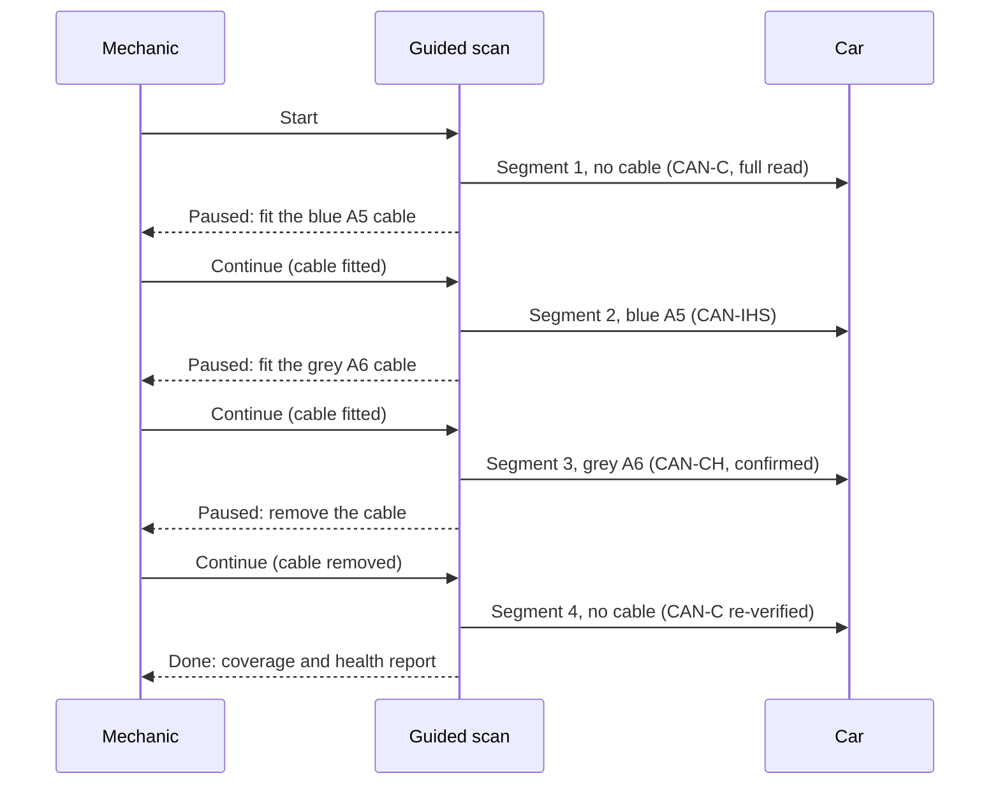

# Guided Full Scan

The guided scan reads the whole car in one tracked session at `/v/{vin}/scan`. Because the adapter has one CAN peripheral, buses are read one after another and the cable is swapped by hand between segments. The code is `cuore/live/fullscan.py`; the same session is available to Claude Code as `guided_scan_start`, `guided_scan_continue`, `guided_scan_skip` and `guided_scan_state`.

## Segments

| Segment | Cable declared | Bus read |
|---|---|---|
| 1 | none | **CAN-C**: adapter identity, VIN, Mode 09, Modes 03/07/0A codes, freeze frames, readiness, Mode 06, PID snapshot, then a UDS sweep of every CAN-C module |
| 2 | blue A5 | **CAN-IHS**: UDS sweep |
| 3 | grey A6 | **CAN-CH**: UDS sweep, each request confirmed |
| 4 | none | **CAN-C** again: re-verify the bus with the cable removed |

## Steps inside segment 1

1. Verify CAN-C (an active Mode 01 request, because the bus is gateway-silent).
2. Adapter identity and VIN (Mode 09).
3. Stored, pending and permanent codes (Modes 03, 07, 0A).
4. Freeze frames and readiness (Mode 01 PID 01 and 41, with the warm-up and distance counters that make readiness interpretable).
5. Mode 06 on-board test results.
6. A snapshot of Mode 01 PIDs, in batches of up to six per request, in one held session.
7. A UDS sweep of every known CAN-C module: codes (`19 02`), identity data identifiers and a short list of named data identifiers, again in one held session per bus.

## The EVAP bundle

If segment 1 finds an **active EVAP code on the engine computer**, an EVAP snapshot bundle is captured in the same segment: the decoded freeze-frame snapshot and extended data for P044x and P045x codes. This is the evidence that is destroyed by a code clear, so it is taken before anything else can happen.

## Rules of the sequence

- Segment 1 runs at once on Start; each later segment waits for an explicit **Continue** naming the cable that is fitted. Fitting the grey cable is the CAN-CH confirmation.
- **Cables may be done out of order** (accepted since 2026-10-15). A segment whose sweep reached no module is recorded as **failed** and stays open; it is not "done".
- A segment can be **skipped**, and the whole session **abandoned**. A skipped or abandoned segment is recorded as a gap with a reason, not as a clean result. A module on a bus that was never reached is reported `not_reachable` ("needs blue A5 cable"), never "no faults".
- The scan **refuses to start** while MultiEcuScan is connected, while the live-data poller holds the adapter, or while another guided scan is open.
- State is saved after each segment (`fullscan_guided.json`) so a page reload or an MCP reconnect resumes the same session. A coverage roll-up is recorded as a `scan_coverage` observation each time.
- A single-call variant performs the same reads over whichever buses the declared cable reaches and reports the others as not reachable.

### The older coverage wizard

`/coverage` follows the same idea with a baseline: CAN-C is read first with no cable and again at the end. An active code that appears between the two reads is reported as a likely **bystander created by the cable changes**, not as a fault. A negative response from a module counts as a live node. This matters because serial sweeps and cable re-plugs are known to manufacture lost-communication codes on neighbouring modules.

## Scan requirements

`cuore/data/scan_requirements.json` is an explicit, checked list of what every scan of the reference car must capture for the open EVAP job. There are 15 items:

| Item | Source type |
|---|---|
| Readiness since clear (Mode 01 PID 01) | legislated |
| Mode 06 EVAP tests | legislated |
| Enabling PIDs (fuel level, ambient temperature, purge command, vapour pressure ...) | legislated |
| Modes 03, 07, 0A codes | legislated |
| Mode 09 calibration identifiers | legislated |
| Engine computer codes with status bytes | UDS |
| Engine computer identity | UDS |
| Battery sensor (IBS) identifiers | data identifier |
| Body computer codes | UDS |
| EVAP bundle | bundle |
| MES clear sync | MES sync |
| ESIM switch state | mechanic input |
| ESIM wire voltage | mechanic input |
| ESIM fit and orientation | mechanic input |
| SLVT result | mechanic input |

For each scan every requirement is marked:

| Status | Meaning |
|---|---|
| `met` | an observation of the required kind exists in the scan's time window |
| `silent` | the read was attempted and the legislated route returned no data; reported as a **tool fault**, not a car fault |
| `missing` | no observation of that kind |
| `na` | does not apply (for example the EVAP bundle when no EVAP code is active) |

The four items only the mechanic can supply are listed as "needs mechanic" with the reason and are never counted as failures. The scan health report combines this with coverage and per-code repair states. A related **scan plan** states ten scans for a diagnosis, from the baseline after the last clear to the release scan, and settles each row against the scans on file; only a complete scan marks a row done. The working rule is about ten full scans over a whole diagnosis, not one per question.

## Out-of-order cables and recovery

If the wrong cable is on, the wizard names the cable it expects; declare what is fitted and continue, or skip. If the grey cable is not at hand, skip the segment: the record says "not reachable: skipped, needs grey A6 cable" and moves to the closing step. Abandoning is honest: the session closes without pretending to be complete.

Related: [[Vehicle Networks|Vehicle-Networks]], [[Evidence Model|Evidence-Model]], [[Hardware and Cables|Hardware-and-Cables]].
